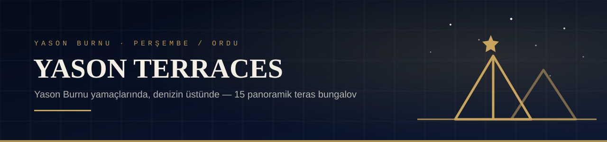
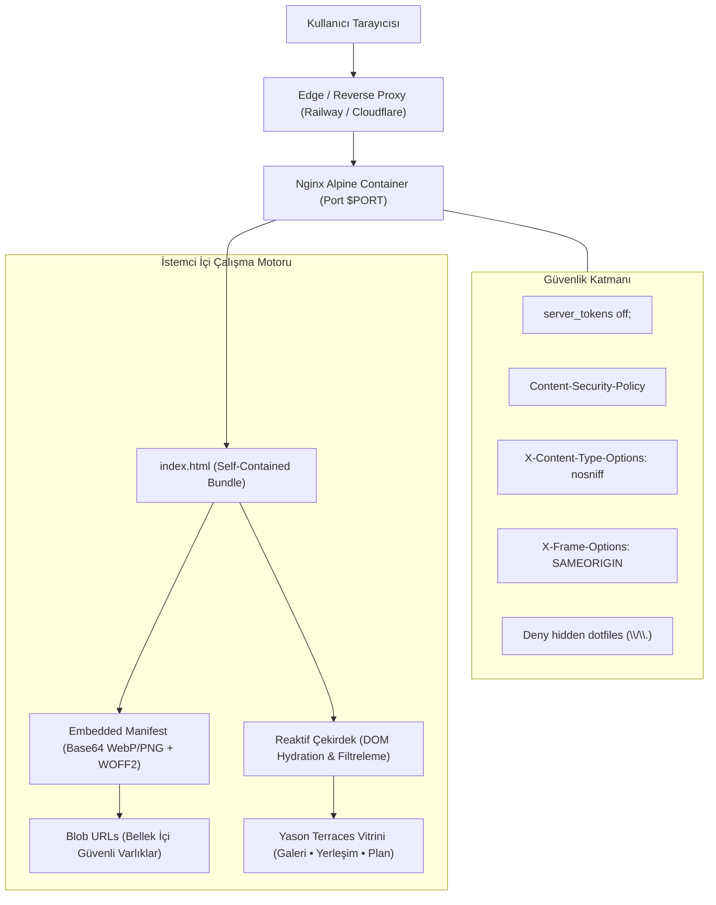

<div align="center">


### Yason Burnu yamaçlarında, denizin üstünde — 15 panoramik teras bungalov

[](https://github.com/Voyagerroc/yason-terraces/actions/workflows/ci.yml)
[](Dockerfile)
[](LICENSE)
[](nginx.conf.template)

[GitHub Repository](https://github.com/Voyagerroc/yason-terraces) · [GitLab Mirror](https://gitlab.com/Voyagerroc/ASTERA)

</div>

---

## Nedir?

**YASON TERRACES**, Ordu **Perşembe / Çaytepe**'de, tarihi Yason Burnu (Cape Jason) yarımadasının yamaçlarında konumlanan lüks bir mimari konaklama projesinin dijital vitrinidir:
- **15 bağımsız süit / villa**: Doğal yamaç eğimine oturan üç teras kademesinde beş blok halinde planlanmıştır.
- **Özel havuz & şömine**: Her villada Karadeniz'in sonsuz ufkuna bakan özel sonsuzluk havuzu, geniş ahşap seyir güvertesi ve asma kat yatak odası.
- **Tarihi & Doğal Doku**: Argonotlar efsanesinin ve tarihi Yason Feneri'nin kadim mirasını çağdaş modernist mimariyle buluşturan konsept.

Site, sıfır harici ağ bağımlılığıyla çalışan, tüm görsel ve yazı tipi varlıklarını kendi içinde barındıran **kendi kendine yeten (self-contained) tek dosyalık dijital deneyim** olarak paketlenmiştir.

---

## Mimari & Çalışma Prensibi



---

## Güvenlik ve Sıkılaştırma (Security Hardening)

Proje, kurumsal güvenlik ve KVKK gizlilik standartlarına tam uyumlu olarak yapılandırılmıştır:

1. **Nginx Sunucu Sıkılaştırması (`nginx.conf.template`):**
   - `server_tokens off;` ile sunucu sürüm bilgisi ifşası engellenir.
   - `X-Content-Type-Options: nosniff` ile MIME türü istismarları önlenir.
   - `X-Frame-Options: SAMEORIGIN` ve CSP `frame-ancestors 'self'` ile Clickjacking saldırıları engellenir.
   - `Referrer-Policy: strict-origin-when-cross-origin` ile URL/veri sızıntısı önlenir.
   - `Permissions-Policy: camera=(), microphone=(), geolocation=(), payment=()` ile yetkisiz donanım erişimleri kısıtlanır.
   - `location ~ /\. { deny all; }` ile gizli dosyalara (.git, .env vb.) doğrudan erişim kesin olarak engellenir.
   - Yalnızca `GET`, `HEAD` ve `OPTIONS` güvenli HTTP metodları kabul edilir (diğer istekler `405 Method Not Allowed` ile reddedilir).

2. **Konteyner Güvenliği (`Dockerfile`):**
   - Minimal `nginx:alpine` tabanı kullanılır.
   - Otomatik `HEALTHCHECK` direktifi ile konteyner orkestratörleri için durum denetimi sağlanır.
   - Railway ve PaaS platformlarında dinamik `$PORT` değişkeni şablon motoruyla güvenle enjekte edilir.

---

## Yerelde Çalıştırma

### 1. Doğrudan Tarayıcıda Açma (Sıfır Kurulum)
Kök dizindeki `index.html` dosyası tüm varlıkları içinde taşıdığından herhangi bir sunucu kurmadan doğrudan tarayıcı ile açılabilir:
```bash
# Windows
start index.html

# macOS
open index.html

# Linux
xdg-open index.html
```

### 2. Docker ile Çalıştırma
```bash
# İmajı oluştur
docker build -t yason-terraces .

# Konteyneri başlat (localhost:8080)
docker run -d --name yason-terraces -p 8080:80 yason-terraces

# Tarayıcıda görüntüle
http://localhost:8080
```

---

## Bütünlük & Güvenlik Doğrulaması

Depo bütünlüğü ve güvenlik testleri Node.js ile yerelde veya CI ortamında tek komutla test edilebilir:

```bash
node test/verify_integrity.mjs
```

**Test Kapsamı:**
- `index.html` paket varlığı ve boyutu.
- `ASTERA` eski marka kalıntılarının sıfır toleransla denetimi.
- `YASON TERRACES` güncel marka kimliğinin varlığı.
- Dahili manifest ve şablon JSON ayrıştırma doğrulaması.
- Nginx güvenlik başlıkları ve gizli dosya engelleme kuralları.
- Dockerfile `HEALTHCHECK` ve temel imaj standartları.
- Vektör afiş (`banner.svg`) ve `LICENSE` Voyagerroc aidiyeti.

---

## Depo Yapısı

| Yol | Açıklama |
|---|---|
| `index.html` | Kendi kendine yeten tek dosyalık YASON TERRACES sunumu |
| `nginx.conf.template` | Güvenlik başlıkları, sıkıştırma ve dinamik port şablonu |
| `Dockerfile` | Üretim odaklı, güvenlik sıkılaştırmalı Nginx Alpine konteyner tanımı |
| `test/verify_integrity.mjs` | Otomatik bütünlük, marka ve güvenlik denetim paketi |
| `.github/workflows/ci.yml` | GitHub Actions CI/CD ve güvenlik doğrulama iş akışı |
| `.github/assets/banner.svg` | YASON TERRACES yüksek çözünürlüklü marka afişi |
| `LICENSE` | MIT Lisansı — Voyagerroc / Erol Tasci |

---

<div align="center">
<sub>YASON TERRACES · Yason Burnu / Çaytepe, Perşembe / Ordu — Bir <a href="https://github.com/Voyagerroc">Voyagerroc</a> Projesidir</sub>
</div>
