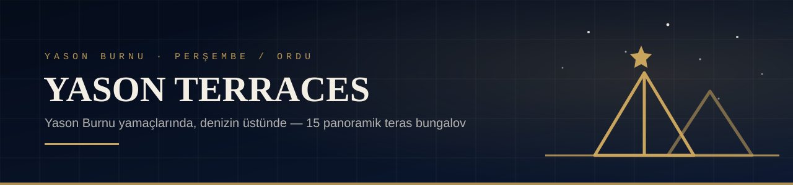

<p align="center">
  <br>
  
</p>

A single-file showcase website for a 15-bungalow architectural concept at Cape Jason (Yason Burnu), Ordu, with an nginx container for deployment.

Ordu Perşembe'deki Yason Burnu yamaçları için tasarlanan 15 bungalovluk konaklama konseptinin tek dosyalık vitrin sitesi. Kendi içinde eksiksiz çalışır; isterseniz nginx konteyneriyle yayınlanır.

**Durum:** konsept vitrini · MIT · sürüm etiketi yok. Görseller render'dır, tamamlanmış bir tesisin fotoğrafı değildir. Canlı önizleme GitHub Pages'te yayında.

[](https://github.com/Voyagerroc/yason-terraces/actions/workflows/ci.yml)

[Canlı önizleme](https://voyagerroc.github.io/yason-terraces/)

## Neyi gösterir

- **15 bağımsız bungalov**, üç teras kademesinde ve beş blokta. Hepsi aynı plan tipindedir: 40 m² alt kat, 15 m² üst kat galeri, 180 m² özel bahçe, 22 m² havuz, 2 m² veranda.
- **Yerleşim planı, konum ve galeri**: Çaytepe / Perşembe / Ordu konumu, ünite ünite plan ve render görselleri. Video bölümü yer tutucudur; tanıtım filmi henüz yüklenmedi.
- **Tek dosya**: Görseller, yazı tipleri ve betikler `index.html` içine gömülüdür. Sayfada form yoktur; iletişim düğmeleri sayfanın iletişim bölümüne gider.

Önizleme görüntüsü `index.html` dosyasının tarayıcıda açılmasıyla alınmıştır; gerçek mekân fotoğrafı veya tamamlanmış bir tesisin kanıtı değildir. GitHub Pages önizlemesi siteyi gösterir; nginx konteynerine ait sunucu ayarlarını uyguladığı varsayılmaz.

## Yerelde çalıştırma

`index.html` tüm varlıkları içinde taşıdığından sunucu kurmadan tarayıcıda açılır.

```powershell
# Windows PowerShell
Invoke-Item .\index.html
```

```sh
# macOS
open index.html

# Linux
xdg-open index.html
```

Docker ile (`localhost:8080`):

```sh
docker build -t yason-terraces .
docker run -d --name yason-terraces -p 8080:80 yason-terraces
```

## Denetimler

Node.js 24 ile statik bütünlük ve yapılandırma kontrolleri tek komutla çalışır. Bu komut canlı güvenlik taraması değildir:

```sh
node test/verify_integrity.mjs
```

Test şunları denetler:

- `index.html` paket varlığı ve boyutu, gömülü manifest ile şablonun JSON olarak ayrışması.
- `YASON TERRACES` marka adının varlığı ve eski marka adının (`ASTERA`) hiçbir kalıntısının olmaması.
- Nginx güvenlik başlıkları ve gizli dosya engelleme kuralı.
- Dockerfile'da sabitlenmiş Alpine temel imajı ve `HEALTHCHECK`.
- `banner.svg` markası ve `LICENSE` Voyagerroc aidiyeti.

CI aynı testi çalıştırır, Docker imajını derleyip başlatır ve HTTP yanıtını kontrol eder; `main` dalında GitHub Pages'e yayınlar. Katkı hazırlığı için [CONTRIBUTING.md](CONTRIBUTING.md) dosyasına bakın.

## Sıkılaştırma

`nginx.conf.template` yalnızca `GET`, `HEAD` ve `OPTIONS` isteklerini kabul eder, nokta ile başlayan yolları reddeder, sürüm bilgisini kapatır ve güvenlik başlıklarını ekler (CSP, HSTS, `X-Content-Type-Options`, `X-Frame-Options`, `Referrer-Policy`, `Permissions-Policy`, COOP ve CORP). `Dockerfile` `nginx:1.31-alpine` tabanını kullanır, `HEALTHCHECK` tanımlar ve platformun verdiği `$PORT` değerini okur (varsayılan `80`). Bunlar kaynak yapılandırmasıdır; bağımsız bir güvenlik derecelendirmesi, canlı sunucu doğrulaması veya hukuki uygunluk belgesi değildir.

| Kanıt alanı | Depodaki kontrol | Ayrı doğrulama gereken |
| --- | --- | --- |
| Kaynak | Bütünlük testi dosyaları, JSON'u ve beklenen ayar metinlerini denetler. | Başlıkların canlı sağlayıcıda uygulanması |
| Konteyner | CI Docker imajını oluşturur, başlatır ve HTTP yanıtını kontrol eder. | Üretim TLS, erişim/log ve sağlayıcı ayarları |
| Arayüz | Gerçek tarayıcı önizlemesi mevcuttur. | Klavye/ekran okuyucu kabulü ve cihaz performansı |
| Gizlilik | Bu kaynak kaydı uygulanan teknik sınırları açıklar. | Fiilî veri akışı, saklama/aktarım ve hukuki değerlendirme |

Özellikle CSP içinde `unsafe-inline`/`unsafe-eval` ve izin verilen kaynaklar bulunur; başlığın varlığı tüm betik risklerini ortadan kaldırmaz. Şüpheli açıkları [SECURITY.md](SECURITY.md) üzerinden özel olarak bildirin.

## Depo yapısı

| Yol | Açıklama |
|---|---|
| `index.html` | Kendi kendine yeten tek dosyalık YASON TERRACES sunumu |
| `nginx.conf.template` | Güvenlik başlıkları, sıkıştırma ve dinamik port şablonu |
| `Dockerfile` | nginx Alpine konteyner tanımı |
| `test/verify_integrity.mjs` | Bütünlük, marka ve yapılandırma denetimi |
| `.github/workflows/ci.yml` | CI: bütünlük testi, Docker derleme ve duman testi, `main` için Pages yayını |
| `.github/assets/banner.svg` | Başlık afişi |
| `docs/assets/preview-desktop.webp` | `index.html` açılış ekranının tarayıcı görüntüsü |
| `LICENSE` | MIT Lisansı, Voyagerroc / Erol Tasci |

---

Erol Taşcı, Voyagerroc Technologies · [voyagerroctechnologies.com](https://voyagerroctechnologies.com/)
