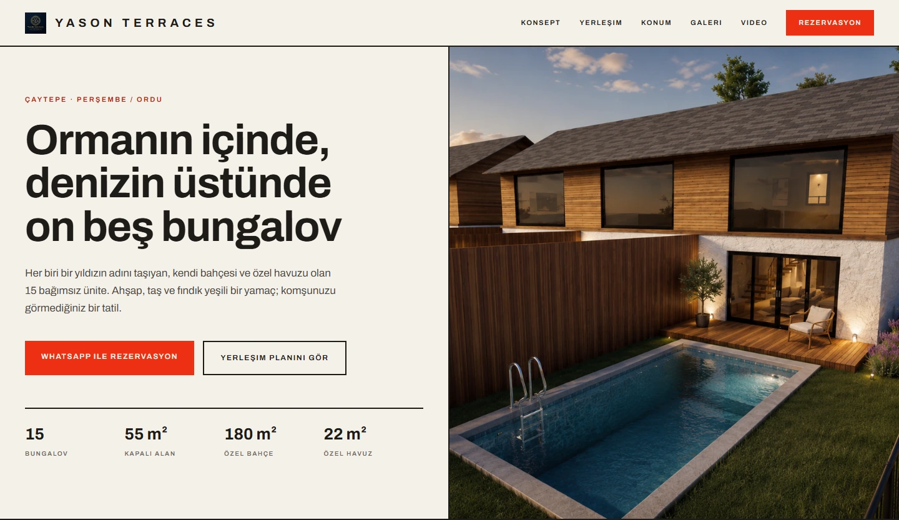

<p align="center">
  <br>
  
</p>

# YASON TERRACES

**A one-page showcase website that presents a planned 15-bungalow holiday retreat on the slopes of Cape Jason (Yason Burnu), Ordu, Turkey.**

> **Türkçe özet:** Ordu Perşembe'deki Yason Burnu yamaçları için tasarlanan 15 bungalovluk konaklama konseptinin tek dosyalık vitrin sitesidir. Dosya tarayıcıda doğrudan açılır; isterseniz nginx konteyneriyle yayınlanır. Görseller render'dır, tamamlanmış bir tesisin fotoğrafı değildir.

[](https://github.com/Voyagerroc/yason-terraces/actions/workflows/ci.yml)

**Status:** client showcase / concept presentation. No release tags. All images are architectural renders, not photos of a finished property. A live preview is published on [GitHub Pages](https://voyagerroc.github.io/yason-terraces/).

## What it does

- Presents **15 independent bungalows** across three terrace levels and five blocks, all of one plan type: 40 m² ground floor, 15 m² upper gallery, 180 m² private garden, 22 m² pool and 2 m² veranda.
- Shows the site plan, location (Çaytepe / Perşembe / Ordu), unit-by-unit plans and a render gallery.
- Works as a **single self-contained file**: images, fonts and scripts are embedded in `index.html`, so it opens offline with no server.
- Has no forms; contact buttons jump to the page's contact section. The video section is a placeholder (no film uploaded yet).

## Who it is for

- **Prospective guests, investors and partners** who want a quick visual idea of the planned retreat.
- **The client and project team**, as a shareable presentation of the concept.
- **Developers** looking for an example of a single-file static site with a hardened nginx container.

## For developers

**Tech stack:** a single static HTML file (embedded assets), nginx (`nginx:1.31-alpine`) in Docker, a Node.js 24 integrity test, GitHub Actions CI with GitHub Pages deployment.

### Repo layout

| Path | Purpose |
|---|---|
| `index.html` | The self-contained YASON TERRACES presentation |
| `nginx.conf.template` | Security headers, compression and dynamic port template |
| `Dockerfile` | nginx Alpine container definition with `HEALTHCHECK` |
| `test/verify_integrity.mjs` | Integrity, branding and configuration checks |
| `.github/workflows/ci.yml` | CI: integrity test, Docker build and smoke test, Pages deploy from `main` |
| `docs/assets/preview-desktop.webp` | Browser screenshot of the landing screen |

### Run locally

`index.html` carries all its assets, so just open it in a browser:

```sh
open index.html          # macOS
xdg-open index.html      # Linux
```

```powershell
Invoke-Item .\index.html # Windows PowerShell
```

With Docker (serves on `localhost:8080`):

```sh
docker build -t yason-terraces .
docker run -d --name yason-terraces -p 8080:80 yason-terraces
```

The container reads the platform-provided `$PORT` (default `80`).

### Checks

Static integrity and configuration checks run with Node.js 24 (this is not a live security scan):

```sh
node test/verify_integrity.mjs
```

It verifies that `index.html` exists and parses its embedded manifest and template as JSON, that the `YASON TERRACES` brand is present and no trace of the old brand name remains, the nginx security headers and hidden-file blocking rule, the pinned Alpine base image and `HEALTHCHECK` in the Dockerfile, and the branding in `banner.svg` and `LICENSE`. CI runs the same test, builds and starts the Docker image, checks the HTTP response, and publishes to GitHub Pages on `main`.

### Hardening

`nginx.conf.template` accepts only `GET`, `HEAD` and `OPTIONS`, rejects dot-prefixed paths, hides the server version and adds security headers (CSP, HSTS, `X-Content-Type-Options`, `X-Frame-Options`, `Referrer-Policy`, `Permissions-Policy`, COOP, CORP). Note that the CSP still allows `unsafe-inline`/`unsafe-eval`. This is source configuration, not an independent security rating, a verified live deployment or a legal compliance certificate; the GitHub Pages preview does not apply these nginx settings.

## Links

- Live preview: <https://voyagerroc.github.io/yason-terraces/>
- [CONTRIBUTING.md](CONTRIBUTING.md) · [SECURITY.md](SECURITY.md) (report suspected vulnerabilities privately)
- License: [MIT](LICENSE)

---

Built by Voyagerroc Technologies · [voyagerroctechnologies.com](https://voyagerroctechnologies.com/)
